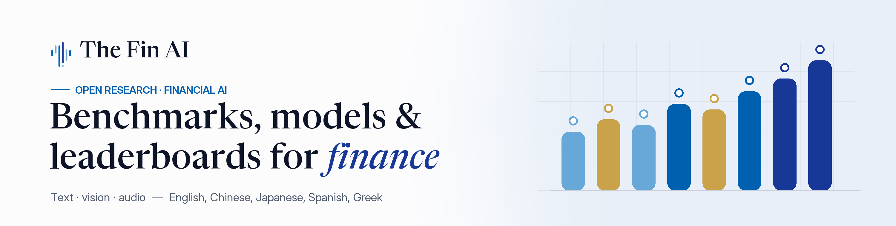

  
  
  
  

**The Fin AI** is a global academy advancing financial general intelligence through education, open research and incubation. This is where our **code** lives — evaluation frameworks, benchmarks, models and agent systems for financial AI. Datasets, model weights and live leaderboards are on [Hugging Face](https://huggingface.co/TheFinAI).

### 🎯 Our vision

> **Open-source, trustworthy Financial General Intelligence** — pursued together by researchers, engineers and financial experts around the world. *AI Readiness in Finance.*

| | |
|---|---|
| 🎓 **Education** | Bringing and educating the next generation of financial AI researchers and talents through courses, study groups and hands-on learning. |
| 🔬 **Research** | Driving rigorous and transparent research with open benchmarks, models and agent systems that advance the science of financial AI. |
| 🚀 **Incubation** | Transforming ideas into impactful financial AI solutions by supporting early-stage teams with guidance, resources and real-world use cases. |

### 📊 Benchmarks & evaluation

| Project | What it is | Paper | Data |
|---|---|---|---|
| [**PIXIU**](https://github.com/The-FinAI/PIXIU) | FinMA models, instruction data and the FLARE evaluation suite | [2306.05443](https://arxiv.org/abs/2306.05443) | [🤗](https://huggingface.co/collections/TheFinAI/finben-and-pixiu-english-financial-evaluation-658f515911f68f12ea193194) |
| [**FinBen**](https://github.com/The-FinAI/FinBen) | Holistic financial benchmark for LLMs | [2402.12659](https://arxiv.org/abs/2402.12659) | [🤗](https://huggingface.co/collections/TheFinAI/finben-and-pixiu-english-financial-evaluation-658f515911f68f12ea193194) |
| [**MultiFinBen**](https://github.com/xueqingpeng/MultiFinBen) | Multilingual & multimodal financial evaluation | [2506.14028](https://arxiv.org/abs/2506.14028) | [🤗](https://huggingface.co/collections/TheFinAI/multifinben-multilingual-and-multimodal-financial-evaluation-6826f6fc4bc13d8af4fab223) |
| [**Ebisu**](https://github.com/The-FinAI/Ebisu) | Japanese financial language evaluation | [2602.01479](https://arxiv.org/abs/2602.01479) | [🤗](https://huggingface.co/collections/TheFinAI/ebisu-japanese-financial-evaluation-6ac7153a5be985dedba08c78) |
| [**CALM**](https://github.com/The-FinAI/CALM) | Credit scoring and risk assessment | [2310.00566](https://arxiv.org/abs/2310.00566) | [🤗](https://huggingface.co/collections/TheFinAI/calm-credit-scoring-and-risk-assessment-6ac7153781499dcd5001572e) |
| [**FinTagging**](https://github.com/The-FinAI/FinTagging) | XBRL tagging of financial reports | [2505.20650](https://arxiv.org/abs/2505.20650) | [🤗](https://huggingface.co/collections/TheFinAI/fintagging-xbrl-tagging-68270132372c6608ac069bef) |
| [**FinAuditing**](https://github.com/The-FinAI/FinAuditing) | Taxonomy-structured, multi-document auditing (SIGIR 2026) | [2510.08886](https://arxiv.org/abs/2510.08886) | [🤗](https://huggingface.co/collections/TheFinAI/finauditing-taxonomy-structured-auditing-68e5f80606e22454027075e7) |
| [**FinCriticalED**](https://github.com/The-FinAI/FinCriticalED) | Fact-level OCR of financial documents | [2511.14998](https://arxiv.org/abs/2511.14998) | [🤗](https://huggingface.co/collections/TheFinAI/fincriticaled-fact-level-financial-ocr-6ac7153c3d632745cc3f7f01) |
| [**Conv-FinRe**](https://github.com/The-FinAI/Conv-FinRe) | Conversational financial recommendation | [2602.16990](https://arxiv.org/abs/2602.16990) | [🤗](https://huggingface.co/collections/TheFinAI/conv-finre-conversational-financial-recommendation-69880c8328d2264727b74fb5) |

### 🧠 Models & methods

| Project | What it is | Paper |
|---|---|---|
| [**Fino1**](https://github.com/The-FinAI/Fino1) | Reasoning-enhanced financial LLMs (8B / 14B) | [2502.08127](https://arxiv.org/abs/2502.08127) |
| [**FinSeer**](https://github.com/The-FinAI/FinSeer) | Retrieval-augmented financial time-series forecasting | [2502.05878](https://arxiv.org/abs/2502.05878) |
| [**HARMONIC**](https://github.com/The-FinAI/HARMONIC) | LLMs for tabular data synthesis and privacy protection | [2408.02927](https://arxiv.org/abs/2408.02927) |
| [**CommitteeAudit**](https://github.com/The-FinAI/CommitteeAudit) | The "standing committee" in Mixture-of-Experts models (ACL 2026) | [2601.03425](https://arxiv.org/abs/2601.03425) |

### 🤖 Agents & trading

| Project | What it is | Paper |
|---|---|---|
| [**Agent Market Arena**](https://github.com/The-FinAI/Agent_Market_Arena) | Live multi-market trading benchmark for LLM agents · [live arena](https://huggingface.co/spaces/TheFinAI/Agent-Market-Arena) | [2510.11695](https://arxiv.org/abs/2510.11695) |
| [**FinCon**](https://github.com/The-FinAI/FinCon) | LLM multi-agent system for financial decision making (NeurIPS 2024) | [2407.06567](https://arxiv.org/abs/2407.06567) |
| [**trials**](https://github.com/The-FinAI/trials) | Pair trading with hierarchical reinforcement learning | [2301.10724](https://arxiv.org/abs/2301.10724) |

### 🏆 Leaderboards & events

- [Open FinLLM Leaderboard](https://huggingface.co/spaces/TheFinAI/Open-FinLLM-Leaderboard) · [Reasoning Leaderboard](https://huggingface.co/spaces/TheFinAI/open-finllm-reasoning-leaderboard) · [Greek Financial LLM Leaderboard](https://huggingface.co/spaces/TheFinAI/Open-Greek-Financial-LLM-Leaderboard)
- [FinReason Cup 2026](https://the-finai.github.io/IEEE-bigdata-cup/) — IEEE Big Data Cup: agentic financial reasoning, hedging & audit
- [FinNLP 2026](https://the-finai.github.io) — 11th Workshop on Financial Technology and NLP, co-located with EMNLP 2026

### 🤝 Get involved

Questions or ideas? Open an issue on the relevant repository, or join us on [Discord](https://discord.gg/Wpt347rusk) and [Google Groups](https://groups.google.com/g/the-fin-ai). More at [thefin.ai](https://thefin.ai) · [YouTube](https://www.youtube.com/@TheFinAI-g6j/featured).
